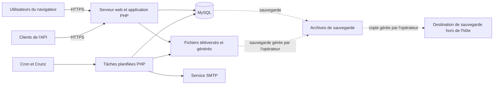
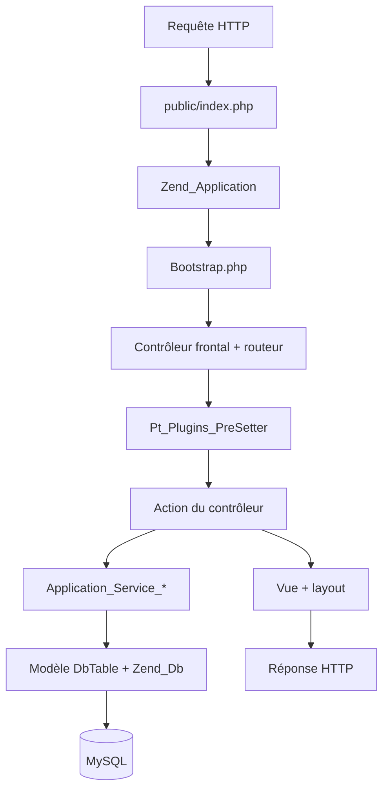
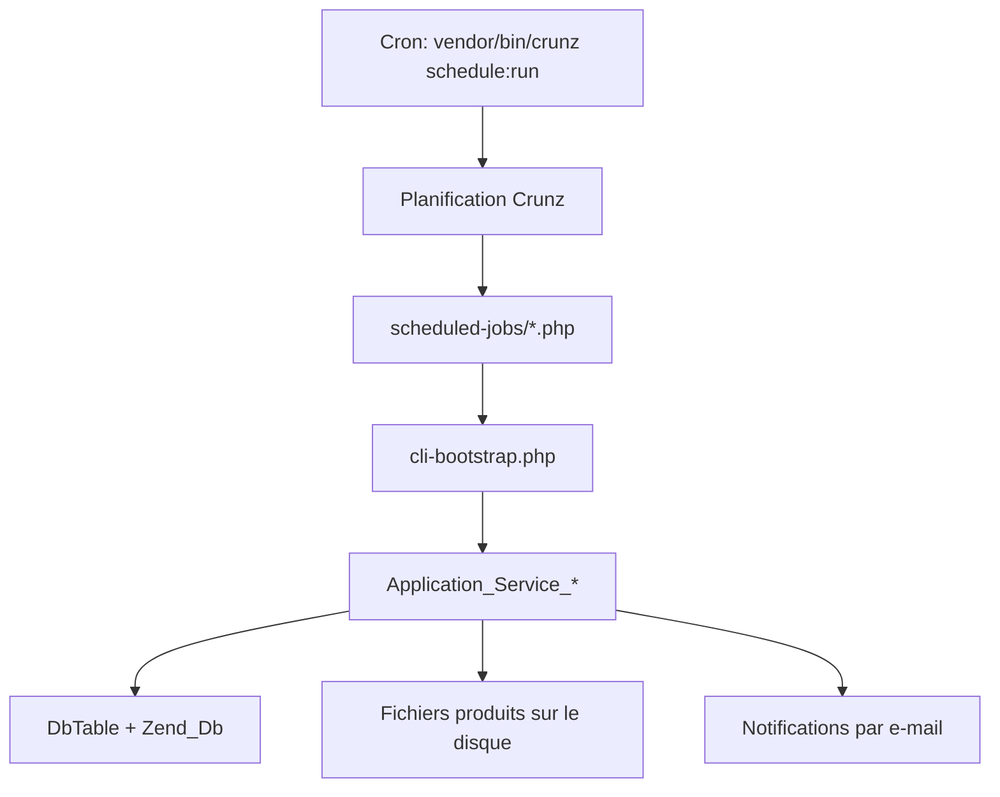

# Architecture du code d'ePT (PHP 8.4 + Zend Framework 1)

Ce document décrit la structure générale et le flux d'exécution du code d'ePT.

Version de référence examinée : ePT 7.6.21. Consultez les [contrôles de sécurité](security.md),
le [modèle de données](data-model.md) et l'[inventaire de l'API](api-reference.md) pour les références complémentaires.

## Composants du déploiement {#deployment-components}



L'application est un monolithe modulaire. Ce n'est pas un déploiement en microservices.
Le diagramme montre les composants logiques. L'emplacement réel des machines virtuelles, les limites réseau et
les destinations de sauvegarde figurent dans le dossier de déploiement de l'installation.
Les flèches de sauvegarde décrivent des dispositions opérationnelles requises. Elles ne désignent pas des services vérifiés en fonctionnement.

## Vue d'ensemble {#high-level-overview}

- Application MVC Zend Framework 1 (ZF1) avec le module par défaut et les modules `admin`, `api` et `reports`.
- Les contrôleurs orchestrent les requêtes et délèguent le travail aux classes de service (`application/services`).
- Les classes de service utilisent les modèles ZF1 `Zend_Db_Table` (`application/models/DbTable`) et d'autres modèles.
- Les vues se trouvent dans `application/views` et dans les dossiers propres à chaque module `application/modules/*/views`. Les layouts se trouvent dans `application/layouts`.
- Le travail en arrière-plan s'exécute par des tâches planifiées Crunz dans `scheduled-jobs/`.
- Prise en charge de plusieurs programmes : DTS, VL, EID, TB, Recency et COVID-19, ainsi que des tests personnalisés configurés par l'utilisateur (`generic`).

## Points d'entrée {#entry-points}

- Web : `public/index.php`
- Amorçage CLI (utilisé par les scripts et les tâches) : `cli-bootstrap.php`
- Tâches planifiées : `scheduled-jobs/ScheduledTasks.php` (Crunz)
- Utilitaires CLI : `bin/*.php`, `db-tools.php`, `runner` (installé sous le nom `ept`)

## Cycle de vie d'une requête (web) {#request-lifecycle-web}



### Rôle du Bootstrap {#bootstrap-responsibilities}

- Charge la configuration depuis `application/configs/application.ini`.
- Démarre la session, définit le fuseau horaire et initialise le jeton CSRF.
- Configure les routes du captcha et des téléchargements.
- Définit un cache de métadonnées par défaut pour `Zend_Db_Table`.
- Initialise la traduction (`application/languages`).

### Plugin du contrôleur frontal {#front-controller-plugin}

- `library/Pt/Plugins/PreSetter.php` applique :
  - Les contrôles CSRF sur les requêtes.
  - Les règles d'authentification du module par défaut et des modules admin et reports.
  - Le changement de layout pour les contextes admin et reports.

## Sécurité {#security}

### Protection CSRF {#csrf-protection}

`Application_Service_SecurityService` gère les jetons CSRF :

- Génère des jetons de 64 caractères avec `bin2hex(random_bytes(32))`.
- Les stocke dans l'espace de noms de session `csrf`.
- Valide les requêtes POST, PUT, PATCH et DELETE avec `hash_equals()`, qui compare en temps constant.
- Source du jeton : en-tête `X-CSRF-Token` ou paramètre POST `csrf_token`.
- Exemptions : requêtes CLI, XHR, module API, contrôleur d'erreur, méthodes sans modification et requêtes sans jeton de session.

### Authentification {#authentication}

Authentification par session avec `Zend_Session_Namespace` :

- **Gestionnaires de données** (participants) : espace de noms de session `datamanagers`.
- **Administrateurs** : espace de noms de session `administrators`.
- Fonctionnalités :
  - Processus de vérification de l'adresse e-mail.
  - Blocage après des tentatives de connexion répétées (blocages temporaires ou permanents configurables).
  - Possibilité d'imposer la réinitialisation du mot de passe.
  - Vérification CAPTCHA avant la connexion.
  - Suivi des sessions avec `UserLoginHistory`.
  - Délai d'inactivité web de 120 minutes par défaut. `session.idleMinutes` dans `application.ini` le définit, entre 10 et 480 minutes. L'usurpation d'identité d'un participant a par défaut un délai d'inactivité de 15 minutes.

### Autorisation {#authorization}

`Pt_Plugins_PreSetter` applique le contrôle d'accès :

- L'accès au portail participant exige la session `datamanagers`.
- L'accès au module admin exige la session `administrators`.
- Le plugin de requête laisse passer les administrateurs authentifiés vers les actions `response` et `assay-formats` du portail participant. Les privilèges au niveau des contrôleurs doivent être examinés séparément.
- Les utilisateurs non authentifiés sont redirigés vers la page de connexion.
- Désactivé pour : contrôleur d'erreur, contrôleur d'authentification, captcha, shipment-form.

### Validation des saisies {#input-validation}

- `Pt_Commons_MiscUtility` : utilitaires de nettoyage.
  - `sanitizeFilename()` : nettoyage des noms de fichier par expression régulière.
  - `toUtf8()` : conversion récursive de l'encodage en UTF-8.
  - `cleanString()` : supprime les caractères Unicode invisibles, le BOM et les ZWSP.
- `Application_Service_Common::parseRecipients()` : validation des adresses e-mail, séparées par des virgules ou des points-virgules.
- Validation des adresses e-mail avec `filter_var(FILTER_VALIDATE_EMAIL)`.

## Modules et contrôleurs {#modules-and-controllers}

- Les contrôleurs du module par défaut se trouvent dans `application/controllers`.
- Les contrôleurs des modules se trouvent dans `application/modules/{admin,api,reports}/controllers`.
- Schémas courants :
  - Les contrôleurs appellent des classes de la couche service comme `Application_Service_Common` et `Application_Service_Shipments`.
  - Les services appellent `Application_Model_DbTable_*` pour la persistance.

## Couche service {#service-layer}

- Se trouve dans `application/services/`.
- Contient la logique métier pour :
  - Les expéditions, les participants, les évaluations, les rapports, la sécurité, etc.
- Favorise la réutilisation entre le web, l'API et les tâches planifiées.

## Accès aux données {#data-access}

- `application/models/DbTable/*` suit les conventions de `Zend_Db_Table_Abstract`.
- Configuré par `resources.db.*` dans `application/configs/application.ini`.
- Le schéma de la base de données et les utilitaires se trouvent dans `database/` et `db-tools.php`.

## Gestion des erreurs et journalisation {#error-handling-and-logging}

### Contrôleur d'erreur {#error-controller}

`application/controllers/ErrorController.php` gère les erreurs de l'application :

- **Erreurs 404** : `EXCEPTION_NO_ROUTE`, `EXCEPTION_NO_CONTROLLER`, `EXCEPTION_NO_ACTION`.
- **Erreurs 500** : toutes les autres exceptions de l'application.
- Journalise les erreurs avec des niveaux de priorité (NOTICE pour 404, CRIT pour 500).
- Affiche la pile d'appels selon le paramètre `displayExceptions`.

### Journalisation {#logging}

`library/Pt/Commons/LoggerUtility.php` assure la journalisation de l'application avec Monolog :

- Gestionnaire de fichiers en rotation, avec une conservation de 30 jours.
- Fichier journal : `/logs/logfile.log`, avec le format de date `Y-m-d`.
- Repli sur stderr si le dossier des journaux n'est pas accessible en écriture.
- Méthodes statiques : `logError()` et `logInfo()`.
- Capture automatiquement le fichier et la ligne de l'appelant par la pile d'appels.

## Cache {#caching}

### Cache sur fichiers (par défaut) {#file-based-cache-default}

Configuré dans `application/Bootstrap.php` :

- Backend : fichiers (`application/cache/`).
- Durée de vie : étendue (7200000000 secondes).
- Utilisé pour le cache des métadonnées de `Zend_Db_Table`.

### Cache Redis (facultatif) {#redis-cache-optional}

`library/Pt/Cache/Backend/Redis.php` fournit un cache Redis :

- Implémentation personnalisée d'un backend `Zend_Cache`.
- Prise en charge du cache par étiquettes.
- Gestion de la durée de vie (TTL) par l'expiration Redis.
- Prise en charge des transactions (`multi()`/`exec()`).
- Préfixe des clés pour isoler les espaces de noms.

## Configuration {#configuration}

- `application/configs/application.ini` :
  - Paramètres d'amorçage ZF1, connexion à la base de données, chemins des modules, paramètres de messagerie.
- Tables de base de données `global_config` et `scheme_config` :
  - Paramètres modifiés depuis les pages d'administration : coordonnées de l'organisation, langue et seuils d'évaluation de chaque programme. `config.ini` n'est plus utilisé.
- `constants.php` :
  - Chemins globaux et version.

## Tâches planifiées {#scheduled-jobs}

Crunz exécute les définitions de tâches de `scheduled-jobs/ScheduledTasks.php`.



### Calendrier des tâches {#job-schedule}

| Tâche | Fréquence | Objet |
|-----|-----------|---------|
| `generate-shipment-reports.php` | Chaque minute | Génération des rapports |
| `execute-job-queue.php` | Chaque minute | Traitement de la file des tâches |
| `send-emails.php` | Chaque minute | Traitement de la file des e-mails |
| `reset-stale-jobs.php` | Toutes les 15 min | Reprise des tâches bloquées |
| `db-tools backup` | Chaque jour à 00:45 | Sauvegarde de la base de données |
| `db-tools purge-binlogs` | Chaque jour à 04:05 | Nettoyage des journaux binaires MySQL |
| `backup-config.php` | Dimanche à 01:00 | Copie de `application.ini` |
| `housekeeping.php` | Chaque jour à 03:30 | Suppression des enregistrements éligibles et des fichiers temporaires |
| `check-participant-emails.php` | Toutes les 4 heures, à la minute 15 | Validation des adresses e-mail des participants et des gestionnaires de données |
| `process-bounces.php` | Toutes les 30 minutes | Traitement de la boîte de rejets configurée |
| `process-shipment-deadlines.php` | Chaque minute | Clôture des expéditions éligibles et mise en file de l'évaluation |

Les calendriers utilisent le fuseau horaire configuré. Consultez [stockage et conservation](data-lifecycle.md)
pour le périmètre du nettoyage et [dépannage](troubleshooting.md) pour les contrôles d'exécution.

### File des tâches {#job-queue}

`Application_Model_DbTable_ScheduledJobs` gère la table `scheduled_jobs` :

- Statuts : `pending` → `processing` → `completed`.
- Les tâches sont planifiées par : `scheduleCertificationGeneration()`, `scheduleEvaluation()`.
- `execute-job-queue.php` récupère les tâches en attente (dans l'ordre d'arrivée) et les exécute par le shell.

## Infrastructure de messagerie {#email-infrastructure}

### File des e-mails {#email-queue}

`Application_Model_DbTable_TempMail` gère la table `temp_mail` :

- Statuts : `pending` → `picked-to-process` → `sent`/`failed`/`not-sent`.
- Types d'échec : `smtp-auth`, `connectivity`, `bad-recipient`, `rate-limit`, `content`, `other`.

### Envoi des e-mails {#email-sending}

`scheduled-jobs/send-emails.php` traite la file des e-mails :

- Utilise Symfony Mailer (remplace Zend_Mail).
- Regroupe les destinataires (To + Cc + Bcc) jusqu'à 100 par e-mail.
- Verrou sur fichier (`/tmp/ept_mail_cron.lock`) avec une durée de vie de 10 minutes.
- Pièces jointes : limite de 15 Mo par fichier et de 22 Mo au total par message.

### Configuration {#configuration_1}

Tous les paramètres de messagerie se trouvent dans `application.ini`, jamais dans la base de données.
Ainsi, une sauvegarde de production restaurée ailleurs ne contient aucun identifiant SMTP.
`Application_Service_Common::getMailSettings()` est le seul point de lecture. La page
Global Config écrit les mêmes clés avec `updateMailSettings()`.

```ini
email.host = "smtp.example.com"
email.config.port = "587"
email.config.ssl = "tls"
email.config.auth = "login"
email.config.username = "..."
email.config.password = "..."
email.fromName = "ePT System"
email.fromEmail = "..."   ; defaults to the username
email.cc = ""
email.bcc = ""
```

### Surveillance de l'état {#health-monitoring}

`Application_Service_Common::getEmailHealthStatus()` suit les taux d'échec :

- Période configurable (7 jours par défaut).
- Niveaux de gravité : ok, avertissement (>5 %), critique (>15 %).

## Module API {#api-module}

### Structure {#structure}

Contrôleurs de l'API dans `application/modules/api/controllers/` :

- `LoginController` : authentification, réinitialisation du mot de passe.
- `ShipmentsController` : points d'accès aux données des expéditions.
- `ParticipantController` : points d'accès aux données des participants.
- `InitController` : initialisation et configuration.
- `AggregatedInsightsController` : analyses et rapports.

### Format des réponses {#response-format}

- La plupart des actions de données renvoient du JSON. Les actions de téléchargement des rapports des participants affichent des vues.
- Lecture de la requête : `json_decode(file_get_contents('php://input'))`.
- Réponse : `json_encode($result, JSON_PRETTY_PRINT)`.

### Services de l'API {#api-services}

`Application_Service_ApiServices` fournit :

- L'authentification par `authToken`.
- La conversion des résultats pour DTS, VL, EID et les tests personnalisés. L'inventaire actuel des contrôleurs ne contient pas d'actions de réponse dédiées aux autres programmes.
- Les données de référence : kits de test, résultats possibles, motifs de non-réalisation du test. Les résultats possibles de Recency sont renvoyés sous la clé `dts`.

Les contrôles d'authentification diffèrent selon le point d'accès. Le module ne fournit pas un garde
d'authentification uniforme. Consultez les [limites de l'API](api-reference.md#integration-boundaries).

## Migrations de la base de données {#database-migrations}

### Système de migration {#migration-system}

`bin/migrate.php` gère les migrations de la base de données :

- Migrations SQL dans `database/migrations/`.
- Suivi de version par `system_config.app_version`.
- Utilise `version_compare()` pour exécuter les migrations égales ou supérieures à la version actuelle de la base de données. La version actuelle est donc rejouée.
- Fonctions utilitaires pour un DDL idempotent.
- Options : `-d` (essai à blanc), `-y` (poursuite automatique), `-q` (mode silencieux), `-v VERSION` (version de départ), `--status` (état des migrations).

### Scripts à exécution unique {#run-once-scripts}

`bin/run-once.php` exécute des scripts de configuration à usage unique :

- Table de suivi : `run_once_scripts`.
- Empêche une nouvelle exécution d'un script déjà exécuté.

## Bibliothèque et utilitaires {#library-and-helpers}

- Les bibliothèques personnalisées se trouvent dans `library/Pt`.
- Zones notables :
  - `Pt/Plugins` (points d'accroche au niveau des requêtes)
  - `Pt/Helper/View` (assistants de vue)
  - `Pt/Reports` (utilitaires de génération des rapports)
  - `Pt/Commons` (utilitaires : journalisation, nettoyage)
  - `Pt/Cache` (backend Redis)

## Ressources et fichiers publics {#assets-and-public-files}

- Le point d'entrée public et les ressources se trouvent dans `public/`.
- Les fichiers téléversés et les fichiers temporaires se trouvent dans :
  - `public/uploads`
  - `public/temporary`

## Plan des dossiers {#directory-map}

```
application/
  Bootstrap.php           # Application initialization
  cache/                  # File-based cache storage
  configs/
    application.ini       # ZF1 settings, DB, mail
  controllers/            # Default module controllers
  languages/              # Translation files
  layouts/                # View layouts
  models/
    DbTable/              # Zend_Db_Table models
  modules/
    admin/                # Admin panel module
    api/                  # REST API module
    reports/              # Reports module
  services/               # Business logic layer
  views/                  # View scripts

library/
  Pt/
    Cache/                # Redis cache backend
    Commons/              # Utilities (logging, misc)
    Helper/               # View helpers
    Plugins/              # Controller plugins
    Reports/              # Report generation

public/
  index.php               # Web entry point
  assets/                 # Static assets
  uploads/                # User uploads
  temporary/              # Temporary files

scheduled-jobs/
  ScheduledTasks.php      # Crunz schedule definitions
  *.php                   # Individual job scripts

database/
  migrations/             # SQL migration files
  schema/                 # Database schema

bin/
  migrate.php             # Migration runner
  run-once.php            # One-time script runner
  *.php                   # CLI utilities

logs/                     # Application logs
```

## Tests {#testing}

Le dépôt contient des bancs d'essai de l'évaluateur pour certains algorithmes DTS et pour les tests personnalisés qualitatifs.
Il contient aussi des contrôles PHPStan et de style de code.
Ces éléments n'établissent ni une couverture complète de l'application ni l'acceptation d'un déploiement.
Consultez le [dossier de validation](validation.md) pour la couverture, les limites et les cas d'acceptation proposés.

## Notes pour les mainteneurs {#notes-for-maintainers}

- Les modules ZF1 partagent les mêmes services et modèles. Ne dupliquez pas la logique métier dans les contrôleurs.
- Ajoutez de préférence les nouveaux comportements partagés dans `application/services` et gardez les contrôleurs légers.
- Utilisez `cli-bootstrap.php` pour tout nouvel outil CLI qui a besoin des configurations ou des services ZF1.
- Le code associe des bibliothèques modernes (Monolog, Symfony Mailer) à des composants ZF1.
- Tout le traitement en arrière-plan repose sur cron (pas de processus démon).
- L'authentification web utilise des sessions. Les services de l'API utilisent une gestion de jetons propre à l'application, et non OAuth ou JWT.
