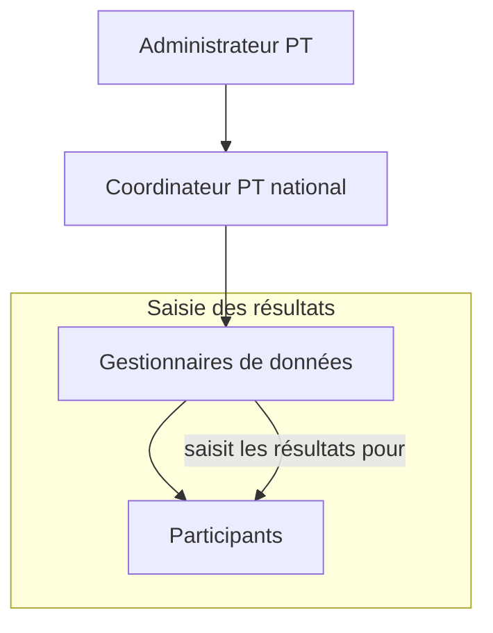
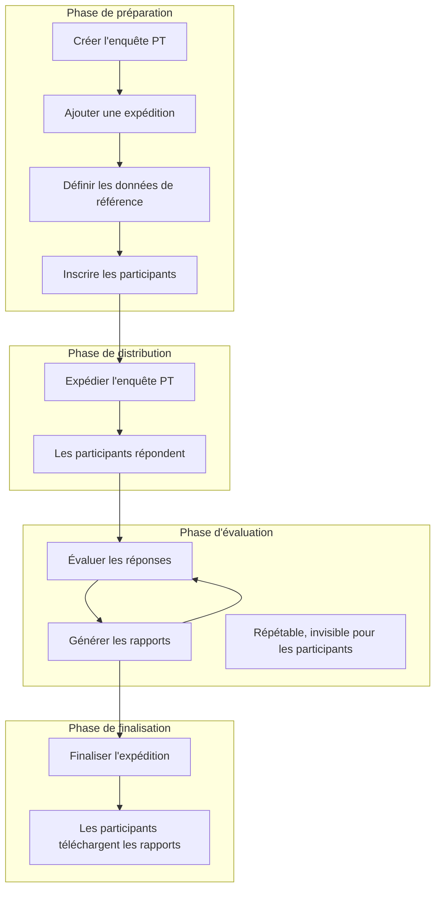
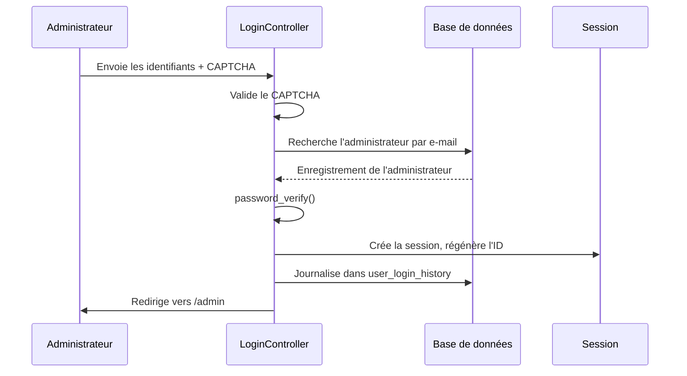
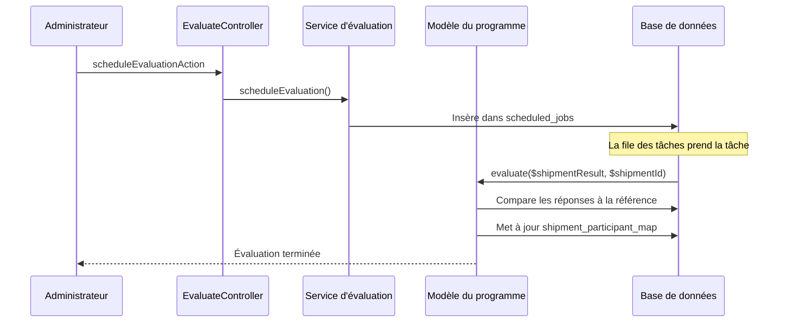

# Guide du module d'administration

Ce document présente le module d'administration d'ePT de manière complète : processus, contrôleurs et détails de mise en œuvre technique.

---

## Table des matières {#table-of-contents}

1. [Vue d'ensemble](#overview)
2. [Rôles des utilisateurs](#user-roles)
3. [Processus métier](#business-workflow)
4. [Authentification et autorisation](#authentication-and-authorization)
5. [Structure du module](#module-structure)
6. [Contrôleurs principaux](#key-controllers)
7. [Schémas AJAX](#ajax-patterns)
8. [Validation des formulaires](#form-validation)
9. [Schémas courants](#common-patterns)
10. [Configuration du système](#system-configuration)
11. [Configurations propres à chaque pays](#country-specific-configurations)

---

## Vue d'ensemble {#overview}

Le module d'administration (`/admin`) est l'interface du fournisseur PT. Il sert à gérer tout le cycle des essais d'aptitude. Il prend en charge :

- **Gestion des enquêtes PT** : créer et gérer les événements et distributions PT
- **Gestion des expéditions** : ajouter des panels de test aux enquêtes, avec les données de référence
- **Gestion des participants** : ajouter, inscrire et suivre les participants
- **Évaluation** : noter les réponses des participants par rapport aux données de référence
- **Génération des rapports** : générer des rapports Excel et PDF
- **Configuration du système** : kits de test, techniques, modèles d'e-mail, etc.

### Terminologie {#terminology}

| Terme | Autres noms | Description |
|------|---------------|-------------|
| **Enquête PT** | Événement PT, distribution PT | Regroupe une ou plusieurs expéditions |
| **Expédition** | Panel | Un test précis dans une enquête (un seul type de programme) |
| **Programme** | Type de test | DTS, VL, EID, TB, Recency, COVID-19, tests personnalisés |
| **Participant** | Laboratoire, site, testeur | Entité qui reçoit les expéditions PT et y répond |
| **Gestionnaire de données** | Utilisateur du laboratoire | Personne qui se connecte pour saisir les résultats au nom des participants |
| **PTCC** | Coordinateur PT national | Utilisateur national ou régional qui supervise les gestionnaires de données |

---

## Rôles des utilisateurs {#user-roles}

### Hiérarchie des rôles {#role-hierarchy}



### Participants (testeurs) {#participants-testers}

Les participants sont les entités dont on évalue l'aptitude. Il peut s'agir :

- **De personnes** : un testeur individuel
- **De cliniques ou de laboratoires de dépistage** : une organisation qui réalise les tests

À la création d'une expédition, **ce sont les participants qui sont inscrits** (pas les gestionnaires de données). Chaque participant reçoit les échantillons, réalise les tests, puis ses résultats sont évalués.

### Gestionnaires de données {#data-managers}

Les gestionnaires de données sont les utilisateurs qui se connectent réellement à ePT pour :

- **Saisir les résultats des tests** au nom des participants
- **Télécharger les rapports** des participants qui leur sont attribués
- **Suivre l'état des expéditions** et les dates limites

**Règles principales :**

| Règle | Description |
|------|-------------|
| Association minimale | Chaque participant doit avoir au moins un gestionnaire de données attribué |
| Plusieurs participants | Un gestionnaire de données peut gérer plusieurs participants |
| Autogestion | Un participant peut être son propre gestionnaire de données |

**Cas d'usage : gestion à distance**

Dans les zones où l'accès à Internet ou à un ordinateur est limité, les testeurs ne peuvent pas toujours saisir les résultats eux-mêmes. Un gestionnaire de données (par exemple dans un bureau régional) peut être chargé de saisir les résultats de plusieurs sites de dépistage éloignés.

### Coordinateurs PT nationaux (PTCC) {#pt-country-coordinators-ptcc}

Les PTCC sont des utilisateurs de niveau national ou régional qui :

- **Ne gèrent pas le PT** (ils ne peuvent pas créer d'enquêtes, d'expéditions, etc.)
- **Supervisent les gestionnaires de données** qui leur sont attribués
- **Suivent la participation** dans leur région
- **Appuient la gestion du programme** au niveau du pays

Ce rôle est utile dans les pays où les programmes PT sont décentralisés. Les coordinateurs régionaux y ont besoin de voir la participation locale sans disposer d'un accès d'administration complet.

### Résumé des accès par rôle {#role-access-summary}

| Rôle | Saisir les résultats | Télécharger les rapports | Gérer le PT | Superviser les utilisateurs |
|------|---------------|------------------|-----------|---------------|
| Administrateur PT | Avec les privilèges de modification des réponses | Selon les privilèges | Selon les privilèges | Selon les privilèges |
| PTCC | Non | Oui (attribués) | Non | Oui (gestionnaires de données) |
| Gestionnaire de données | Oui | Oui (attribués) | Non | Non |
| Participant | Par le gestionnaire de données | Par le gestionnaire de données | Non | Non |

---

## Processus métier {#business-workflow}

### Cycle de vie complet du PT {#complete-pt-lifecycle}



### Processus étape par étape {#step-by-step-workflow}

#### 1. Créer l'enquête PT {#1-create-pt-survey}
**Emplacement :** Gérer → Enquête PT → Ajouter une nouvelle enquête PT

- Saisissez le code de l'enquête PT (caractères alphanumériques et traits d'union)
- Sélectionnez la date de l'enquête PT
- L'enquête regroupe plusieurs expéditions

#### 2. Ajouter une ou plusieurs expéditions {#2-add-shipments}
**Emplacement :** Gérer → Enquête PT → **Ajouter une expédition** sur la ligne de l'enquête

**Ajouter une expédition** ouvre la liste des expéditions de cette enquête. Choisissez le **Type de programme**, puis cliquez sur **Nouvelle expédition**.

Pour chaque expédition :
- Définissez le code de l'expédition (généré automatiquement ou personnalisé)
- Définissez la date limite de réponse
- Ajoutez les échantillons de référence avec les résultats attendus (tests qualitatifs)
- Configurez les options propres au programme (algorithmes, panels de test, etc.)

#### 3. Inscrire les participants {#3-enroll-participants}
**Emplacement :** liste des expéditions → bouton **Inscrire** sur la ligne de l'expédition. Le bouton reste rouge tant que l'expédition n'a aucun participant.

- La liste de droite contient les participants qui reçoivent l'expédition. À la première ouverture de la page, elle contient déjà les participants inscrits au programme (Configurer → Inscriptions au programme)
- La liste de gauche contient tous les autres participants actifs
- Cliquez sur un nom pour le déplacer d'une liste à l'autre, puis cliquez sur **Inscrire**

#### 4. Expédier l'enquête PT {#4-ship-the-pt-survey}
**Emplacement :** Gérer → Enquête PT → Expédier maintenant

- Confirme que l'expédition est prête
- Rend l'expédition visible pour les participants inscrits
- Les participants peuvent alors saisir leurs résultats

#### 5. Réponse du participant {#5-participant-response}
**Emplacement :** Portail participant → Envoi des résultats du PT

- Les participants voient les expéditions envoyées
- Ils saisissent les résultats des tests dans le formulaire de réponse
- Ils envoient leur réponse avant la date limite

#### 6. Évaluer les réponses {#6-evaluate-responses}
**Emplacement :** Analyse → Évaluer les réponses → Voir → Évaluer

- Compare les réponses des participants aux données de référence
- Calcule les scores (score de réponse + score de documentation)
- Détermine la réussite ou l'échec
- Peut être exécutée plusieurs fois (invisible pour les participants)

#### 7. Générer les rapports {#7-generate-reports}
**Emplacement :** Analyse → Générer les rapports → Voir → Rapport

- Génère les rapports des participants (Excel, PDF)
- Peut être relancée autant que nécessaire
- Toujours invisible pour les participants

#### 8. Finaliser l'expédition {#8-finalize-shipment}
**Emplacement :** Analyse → Finaliser les rapports → Voir → Finaliser

- Clôture définitivement l'expédition
- Génère les rapports définitifs
- **C'est seulement à ce moment** que les participants peuvent télécharger leurs PDF de résultats
- Ne peut pas être annulée

---

## Authentification et autorisation {#authentication-and-authorization}

### Gestion des sessions {#session-management}

**Espace de noms de la session d'administration :** `administrators`

```php
$adminSession = new Zend_Session_Namespace('administrators');
// Contains: admin_id, primary_email, first_name, last_name, privileges, activeScheme
```

**Durée de la session :** la configuration du cookie « se souvenir de moi » ne remplace pas
le délai d'inactivité web des utilisateurs authentifiés, défini dans `Pt_Plugins_PreSetter`. Ce délai est de 120 minutes par défaut. `session.idleMinutes` dans `application.ini` le définit, entre 10 et 480 minutes.
L'usurpation d'identité d'un participant a par défaut un délai d'inactivité de 15 minutes. Consultez les [contrôles de sécurité](security.md).

### Processus de connexion {#login-flow}



### Responsables PT (utilisateurs administrateurs) {#pt-managers-admin-users}

Les responsables PT sont les utilisateurs qui accèdent à l'espace d'administration (`/admin`). Chaque responsable PT peut recevoir :

1. **Un accès aux programmes** : accès à tous les programmes actifs ou seulement à certains (par exemple, uniquement DTS et TB)
2. **Des privilèges** : tous les privilèges ou seulement certains

### Système de privilèges {#privilege-system}

Les privilèges sont stockés sous forme de valeurs séparées par des virgules dans `system_admin.privileges` :

| Privilège | Accès accordé |
|-----------|---------------|
| `config-ept` | Configurer l'ePT : configuration du système, responsables PT, paramètres globaux |
| `manage-participants` | Gérer les participants : gestion des participants, gestionnaires de données, inscriptions |
| `manage-shipments` | Gérer les expéditions : expéditions, distributions, envoi |
| `analyze-generate-reports` | Analyser et générer des rapports : évaluation, rapports, finalisation |
| `edit-participant-responses` | Modifier les réponses des participants : modifier les données envoyées par les participants |
| `access-reports` | Accès aux rapports : consulter et télécharger les rapports |
| `delete-participants` | Supprimer des participants : supprimer les fiches des participants |
| `replace-finalized-summary-reports` | Remplacer les rapports de synthèse finalisés : remplacer les rapports finalisés |

**Vérifier les privilèges :**
```php
$privileges = explode(',', $adminSession->privileges);
if (!in_array('manage-shipments', $privileges)) {
    $this->redirect('/admin');
}
```

### Protection CSRF {#csrf-protection}

- **Génération du jeton :** chaîne hexadécimale de 64 caractères
- **Stockage :** espace de noms de session `csrf`
- **Validation :** en-tête `X-CSRF-Token` ou paramètre POST `csrf_token`
- **Exemptions :** XHR, API, CLI, routes d'erreur, méthodes sans modification et requêtes sans jeton de session

---

## Structure du module {#module-structure}

### Organisation des dossiers {#directory-layout}

```
application/modules/admin/
├── controllers/           # 41 controller files
│   ├── IndexController.php         # Dashboard
│   ├── LoginController.php         # Authentication
│   ├── ShipmentController.php      # Shipment management
│   ├── DistributionsController.php # PT Survey management
│   ├── ParticipantsController.php  # Participant management
│   ├── EvaluateController.php      # Evaluation & scoring
│   └── ...
│
└── views/scripts/         # View templates by controller
    ├── shipment/
    │   ├── index.phtml
    │   ├── add.phtml
    │   ├── edit.phtml
    │   ├── get-sample-form.ajax.phtml
    │   └── partials/
    │       ├── common/    # Shared form components
    │       └── schemes/   # Scheme-specific forms
    ├── distributions/
    ├── participants/
    ├── evaluate/
    └── ...
```

### Catégories de contrôleurs {#controller-categories}

| Catégorie | Contrôleurs | Objet |
|----------|-------------|---------|
| **Noyau** | IndexController, LoginController | Tableau de bord, authentification |
| **Gestion du PT** | DistributionsController, ShipmentController | Enquêtes et expéditions |
| **Participants** | ParticipantsController, DataManagersController, EnrollmentsController | Gestion des utilisateurs |
| **Évaluation** | EvaluateController | Notation et résultats |
| **Configuration** | GlobalConfigController, TestkitController, divers *SettingsController | Configuration du système |
| **Communication** | EmailParticipantsController, AnnouncementController, AlertsController | Notifications |

---

## Contrôleurs principaux {#key-controllers}

### ShipmentController {#shipmentcontroller}

**Emplacement :** `application/modules/admin/controllers/ShipmentController.php`

**Privilège requis :** `manage-shipments`

#### Actions principales {#key-actions}

| Action | Méthode | Objet |
|--------|--------|---------|
| `indexAction` | GET/POST | Lister les expéditions, avec filtres |
| `addAction` | GET/POST | Créer une expédition dans une distribution |
| `editAction` | GET/POST | Modifier les détails et les échantillons d'une expédition |
| `getSampleFormAction` | POST (AJAX) | Charger le formulaire d'échantillons propre au programme |
| `shipItAction` | GET/POST | Envoyer l'expédition aux participants inscrits |
| `viewEnrollmentsAction` | GET/POST | Voir et gérer les participants inscrits |
| `addEnrollmentsAction` | POST | Inscrire des participants à l'expédition |
| `responseSwitchAction` | POST (AJAX) | Activer ou désactiver l'acceptation des réponses |

#### Services utilisés {#services-used}

```php
$shipmentService = new Application_Service_Shipments();
$schemeService = new Application_Service_Schemes();
$participantService = new Application_Service_Participants();
$distributionService = new Application_Service_Distribution();
```

### EvaluateController {#evaluatecontroller}

**Emplacement :** `application/modules/admin/controllers/EvaluateController.php`

**Privilège requis :** `analyze-generate-reports`

#### Actions principales {#key-actions_1}

| Action | Méthode | Objet |
|--------|--------|---------|
| `indexAction` | GET | Lister les distributions à évaluer |
| `getShipmentsAction` | POST (AJAX) | Obtenir les expéditions d'une distribution |
| `scheduleEvaluationAction` | POST (AJAX) | Mettre en file une tâche d'évaluation |
| `shipmentAction` | GET | Afficher une expédition à évaluer |
| `editAction` | GET/POST | Évaluer avec des corrections manuelles |
| `vlRangeAction` | GET/POST (AJAX) | Configurer les plages de Z-score de charge virale |
| `excludeParticipantAction` | POST (AJAX) | Exclure un participant de la notation |

#### Processus d'évaluation {#evaluation-flow}



### DistributionsController {#distributionscontroller}

**Emplacement :** `application/modules/admin/controllers/DistributionsController.php`

**Privilège requis :** `manage-shipments`

#### Actions principales {#key-actions_2}

| Action | Méthode | Objet |
|--------|--------|---------|
| `indexAction` | GET/POST | Lister les enquêtes PT |
| `addAction` | GET/POST | Créer une enquête PT |
| `editAction` | GET/POST | Modifier une enquête PT |
| `viewShipmentAction` | GET (AJAX) | Obtenir les expéditions d'une enquête |
| `shipDistributionAction` | GET | Envoyer toute l'enquête |
| `generateSurveyCodeAction` | POST (AJAX) | Générer automatiquement le code de l'enquête |

### ParticipantsController {#participantscontroller}

**Emplacement :** `application/modules/admin/controllers/ParticipantsController.php`

**Privilège requis :** `config-ept` OU `manage-participants`

#### Actions principales {#key-actions_3}

| Action | Méthode | Objet |
|--------|--------|---------|
| `indexAction` | GET/POST | Lister les participants (DataTables) |
| `addAction` | GET/POST | Ajouter un participant |
| `editAction` | GET/POST | Modifier un participant |
| `bulkImportAction` | GET/POST | Importer en masse depuis Excel |
| `participantManagerMapAction` | GET/POST | Attribuer des gestionnaires de données |
| `exportParticipantsDetailsAction` | POST (AJAX) | Exporter vers Excel |

### EnrollmentsController {#enrollmentscontroller}

**Emplacement :** `application/modules/admin/controllers/EnrollmentsController.php`

**Privilège requis :** `config-ept` OU `manage-participants`

Les listes d'inscription sont propres à chaque programme. La clé de `enrollments` est (`list_name`, `scheme_id`, `participant_id`). Les listes archivées se trouvent dans `enrollment_list_archive`. La liste `default` ne peut pas être renommée, fusionnée, archivée ni supprimée. Les noms des autres listes sont uniques pour tous les programmes, car Ship It applique les préréglages par nom. `Enrollments::listNameOwner()` est le contrôle utilisé par chaque chemin de création, de renommage, de clonage, d'import et d'attribution.

#### Actions principales {#key-actions_4}

| Action | Méthode | Objet |
|--------|--------|---------|
| `indexAction` | GET/POST | Onglet Listes (GET) et JSON DataTables de Par participant (POST) |
| `addAction` | GET/POST | Éditeur de liste. Un enregistrement XHR renvoie du JSON |
| `listItemsAction` | POST (AJAX) | Lignes de l'éditeur pour les filtres actuels |
| `exportListAction` | POST (AJAX) | Télécharger une liste en Excel, au format d'import |
| `listActionAction` | POST | `op` = `archive`, `reactivate`, `rename`, `clone`, `merge` ou `delete` |
| `assignSchemeAction` | POST | Attribuer son programme à une liste enregistrée sans programme |
| `bulkEnrollmentAction` | GET/POST | Import en masse : Téléverser, Vérification, Terminé |
| `bulkEnrollmentTemplateAction` | GET | Modèle d'import dans la langue de l'administrateur |

---

## Schémas AJAX {#ajax-patterns}

### Enregistrement d'AjaxContext {#ajaxcontext-registration}

Les contrôleurs enregistrent leurs actions AJAX dans `init()` :

```php
public function init()
{
    $ajaxContext = $this->_helper->getHelper('AjaxContext');
    $ajaxContext->addActionContext('get-sample-form', 'html')
        ->addActionContext('get-shipment-code', 'html')
        ->addActionContext('view-enrollments', 'html')
        ->initContext();
}
```

### Organisation courante des fichiers AJAX {#common-ajax-file-pattern}

Les vues AJAX utilisent le suffixe `.ajax.phtml` et renvoient du HTML ou du JSON :

```
views/scripts/{controller}/
├── index.phtml           # Regular view
├── add.phtml
├── get-data.ajax.phtml   # AJAX response (HTML)
└── search.ajax.phtml
```

### DataTables côté serveur {#datatables-server-side}

Utilisé pour les listes paginées :

```javascript
$('#participantsTable').dataTable({
    "bServerSide": true,
    "sAjaxSource": "/admin/participants/index/format/html",
    "fnServerData": function(sSource, aoData, fnCallback) {
        $.ajax({
            type: "POST",
            url: sSource,
            data: aoData,
            success: fnCallback
        });
    }
});
```

### Listes déroulantes AJAX Select2 {#select2-ajax-dropdowns}

Pour les listes déroulantes avec recherche :

```javascript
$("#labId").select2({
    ajax: {
        url: "/reports/common/get-ajax-drop-downs",
        dataType: 'json',
        data: function(params) {
            return { tableName: 'participant', search: params.term };
        },
        processResults: function(data) {
            return { results: data.result };
        }
    }
});
```

### Schéma de réponse JSON {#json-response-pattern}

Pour les réponses de type API :

```php
public function getDataAction()
{
    $this->_helper->layout()->disableLayout();
    $this->_helper->viewRenderer->setNoRender(true);

    $data = $this->service->getData($this->getAllParams());

    $this->getResponse()->setHeader('Content-Type', 'application/json');
    echo json_encode($data);
}
```

---

## Validation des formulaires {#form-validation}

### Côté client : deforayValidator {#client-side-deforayvalidator}

**Emplacement :** `public/js/deforayValidation.js`

Appliquez la validation avec des classes CSS :

```html
<input type="email" name="email"
       class="isRequired isEmail form-control"
       title="Please enter a valid email address">
```

**Validateurs disponibles :**

| Classe | Validation |
|-------|------------|
| `isRequired` | Le champ ne peut pas être vide |
| `isEmail` | Format d'adresse e-mail valide |
| `isNumeric` | Chiffres uniquement |
| `isAlpha` | Lettres uniquement |
| `isAlphaNum` | Caractères alphanumériques uniquement |
| `minLength_N` | Au moins N caractères |
| `maxLength_N` | Au plus N caractères |
| `confirmPassword` | Identique au champ du mot de passe |

**Utilisation :**

```javascript
function validateNow() {
    var flag = deforayValidator.init({ formId: 'shipmentForm' });
    if (flag && !duplicated) {
        $.blockUI();
        document.getElementById('shipmentForm').submit();
    }
}
```

### Contrôle des doublons {#duplicate-checking}

Validation AJAX en temps réel pour les champs uniques :

```html
<input type="text" name="partnerName"
       onblur="checkDuplicate('partners', 'partner_name', 'partnerName', null, 'Name already exists')">
```

Pour les formulaires de modification (en excluant l'enregistrement en cours) :

```html
<input type="text" name="partnerName"
       onblur="checkDuplicate('partners', 'partner_name', 'partnerName',
               'partner_id##<?php echo $this->partner['partner_id']; ?>', 'Name already exists')">
```

### Validation côté serveur {#server-side-validation}

**Service Common** (`application/services/Common.php`) :

```php
// Email validation
$validEmail = $commonService->validateEmail($email);

// Password validation
$result = $commonService->validatePassword($password, $name, $email);

// Required fields
$valid = $commonService->validateRequiredFields($formData, ['field1', 'field2']);
```

---

## Schémas courants {#common-patterns}

### Encodage des paramètres en Base64 {#base64-parameter-encoding}

Les identifiants sensibles sont encodés en base64 dans les URL :

```php
// Encoding (in view)
$encodedId = base64_encode($shipment['shipment_id']);
<a href="/admin/shipment/edit/sid/<?php echo $encodedId; ?>">Edit</a>

// Decoding (in controller)
$shipmentId = (int) base64_decode($this->_getParam('sid'));
```

### Gestion des layouts {#layout-management}

```php
// Set page identifier for menu highlighting
$this->view->pageName = 'manageMenu';

// Disable layout for AJAX
$this->_helper->layout()->disableLayout();

// Use modal layout
$this->_helper->layout->setLayout('modal');
```

### Schéma de la couche service {#service-layer-pattern}

Les contrôleurs délèguent le travail aux services :

```php
// Controller (thin)
public function addAction()
{
    if ($this->getRequest()->isPost()) {
        $this->shipmentService->addShipment($this->getRequest()->getPost());
        $this->redirect('/admin/shipment');
    }
}

// Service (business logic)
public function addShipment($params)
{
    // Validation, transformation, DB operations
    $shipmentDb = new Application_Model_DbTable_Shipments();
    return $shipmentDb->addShipment($params);
}
```

### Redirection après POST {#redirect-after-post}

Schéma standard pour éviter les envois en double :

```php
if ($request->isPost()) {
    $service->processData($request->getPost());
    $this->redirect('/admin/controller');  // Always redirect
}
```

---

## Configuration du système {#system-configuration}

### Paramètres globaux : activation des programmes {#global-config-scheme-activation}

Toutes les installations n'utilisent pas tous les programmes de test. Dans **Configurer → Paramètres globaux d'ePT**, les administrateurs activent ou désactivent les programmes de l'installation :

- Certaines installations n'utilisent que DTS (sérologie VIH)
- Certaines n'utilisent que TB
- Certaines utilisent plusieurs programmes (DTS, VL, EID)
- Des tests personnalisés peuvent être configurés pour les besoins propres à une organisation

À la création d'un responsable PT, vous pouvez lui donner accès à tous les programmes actifs ou seulement à certains.

### Kits de test {#test-kits}

Les kits de test sont un élément essentiel d'ePT :

- **Kits préchargés** : le système contient des kits de test standard, courants dans les programmes PT
- **Kits personnalisés** : les utilisateurs peuvent ajouter leurs propres kits de test, propres à leur région ou à leur programme
- **Attribution des kits** : les administrateurs choisissent les kits de test disponibles pour chaque programme

**Emplacement :** Configurer → Kits de test

### Paramètres propres à chaque programme {#scheme-specific-settings}

Tous les paramètres des programmes se trouvent dans un même centre. Ouvrez **Configurer → Configuration des programmes**, puis choisissez le programme. Chaque programme a une page. Son titre est « Paramètres : » suivi du nom du programme, par exemple « Paramètres : VL ». Les paramètres sont stockés dans la table `scheme_config`.

| Programme | Titre de la page | Paramètres principaux |
|--------|---------------|-------------------|
| DTS | Paramètres : Sérologie du VIH | Type d'algorithme, nombre de tests du panel, options de résultat |
| VL | Paramètres : VL | Liste des techniques, seuils de Z-score, méthodes de référence |
| EID | Paramètres : EID | Règles d'interprétation des résultats |
| TB | Paramètres : TB | Options moléculaire ou microscopie, résistance aux médicaments |
| Recency | Paramètres : Récence du VIH (RTRI) | Seuils RTRI, seuils de charge virale |
| COVID-19 | Paramètres : SARS-CoV-2 | Options de plateforme, plages de valeurs Ct |

**Emplacement :** Configurer → Configuration des programmes. Les anciennes URL de paramètres par programme redirigent vers ce centre.

### Algorithmes à plusieurs tests (sérologie VIH) {#multi-test-algorithms-hiv-serology}

En sérologie VIH (DTS), les participants réalisent souvent plusieurs tests avant de conclure :

```text
Test-1 (Screening) → Test-2 (Confirmatory) → Test-3 (Tiebreaker) → Final Interpretation
```

Les administrateurs configurent :

1. **Les kits de test** disponibles pour chaque position de test (Test-1, Test-2, Test-3)
2. **Les règles de l'algorithme** qui combinent les résultats pour produire l'interprétation finale
3. **Les résultats attendus** pour chaque échantillon de référence

Cela permet de s'adapter aux différents algorithmes nationaux (algorithme OMS à 3 tests, algorithme du Malawi, etc.).

---

## Configurations propres à chaque pays {#country-specific-configurations}

ePT est déployé dans le monde entier, avec des adaptations propres à chaque pays :

### Algorithmes de dépistage {#testing-algorithms}

| Pays | Algorithme |
|---------|-----------|
| Norme OMS | Algorithme à 3 tests |
| Malawi | Algorithme personnalisé avec les champs PT Email et PT Phone |
| Myanmar | Algorithme personnalisé |
| Zimbabwe | Algorithme personnalisé |

Le paramètre `reportType` détermine les champs affichés :

```php
if ($this->reportType == 'malawi') {
    // Show PT Email and PT Phone fields
}
```

### Origine des programmes {#scheme-origins}

| Programme | Description | Remarques |
|--------|-------------|-------|
| **DTS** | Sérologie VIH (échantillon sur tube séché) | Programme d'origine, fonctions principales |
| **VL** | Charge virale VIH | Tests quantitatifs avec analyse du Z-score |
| **EID** | Diagnostic précoce du nourrisson | Dépistage du VIH chez le nourrisson par PCR |
| **TB** | Tuberculose | Moléculaire (GeneXpert) OU microscopie |
| **Recency** | Infection récente par le VIH | Détection des infections récentes par RTRI |
| **COVID-19** | Dépistage de la COVID-19 | Ajouté pendant la pandémie, PCR sur plusieurs plateformes |
| **DBS** | Goutte de sang séché | Tests EIA et Western Blot |
| **Tests personnalisés** | Configurables par l'utilisateur | Ajoutés à la demande des utilisateurs pour les tests propres à une organisation |

---

## Documentation associée {#related-documentation}

- [Guide d'architecture](ARCHITECTURE.md) : architecture de l'ensemble du système
- [Architecture des programmes](SchemeArchitecture.md) : détails de mise en œuvre des programmes de test
- [Index de la documentation](README.md) : toute la documentation
