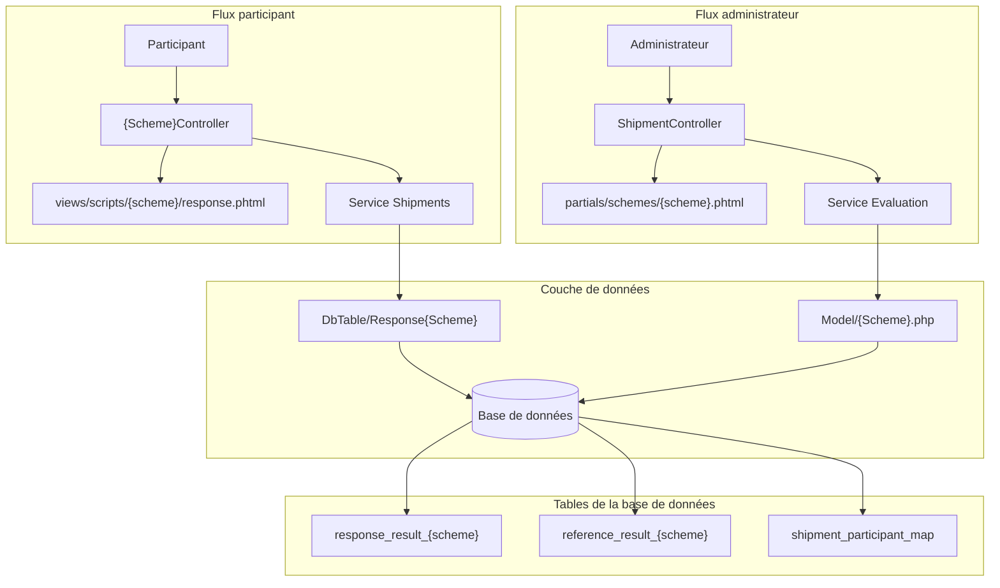
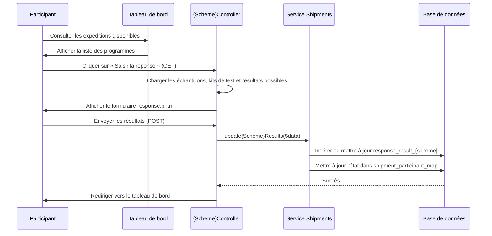
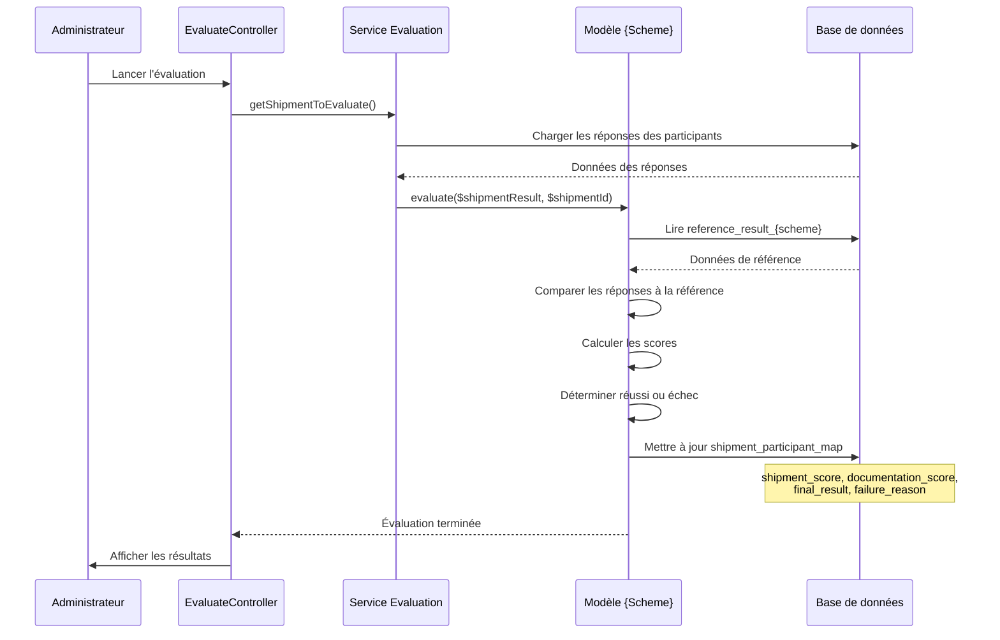
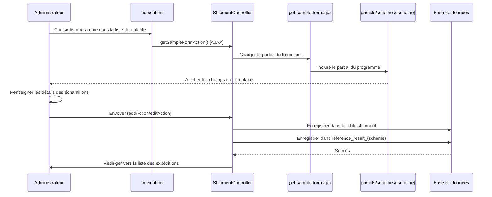
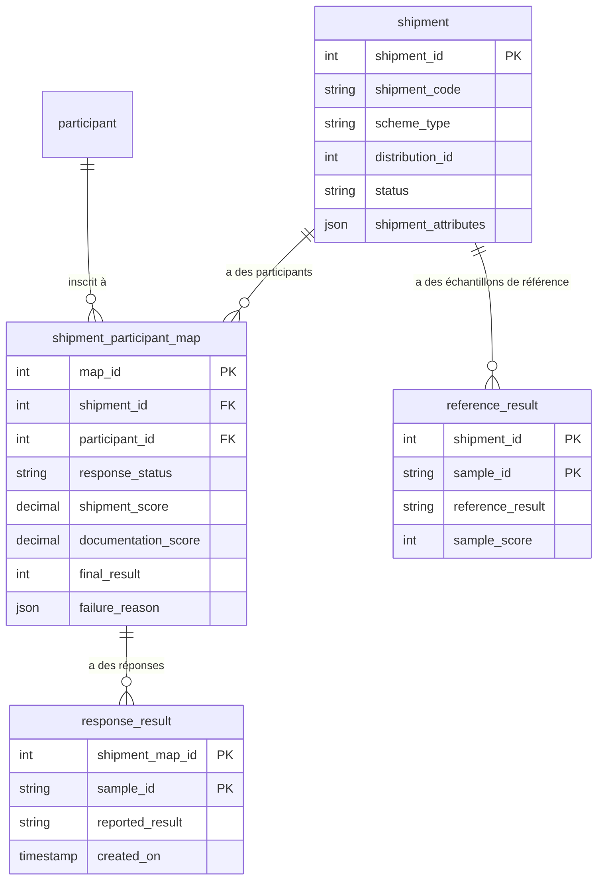
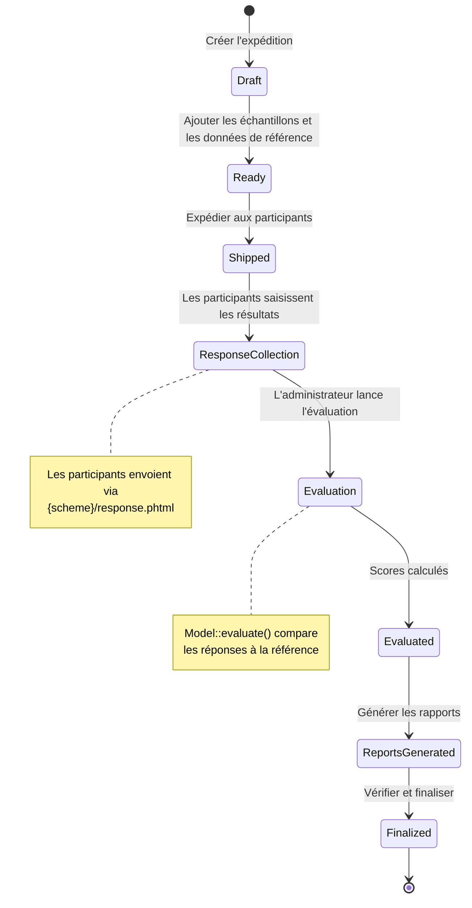
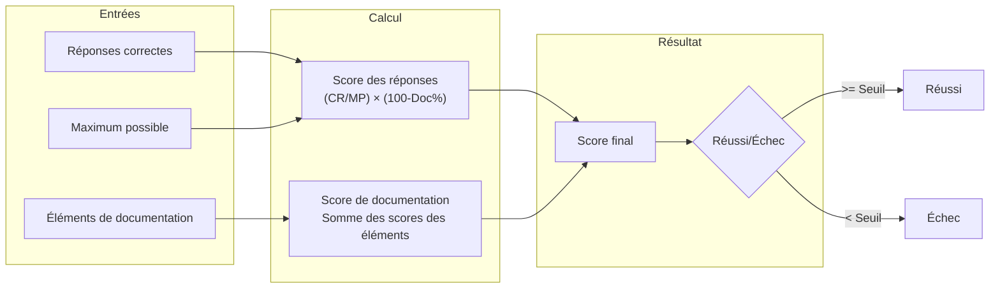
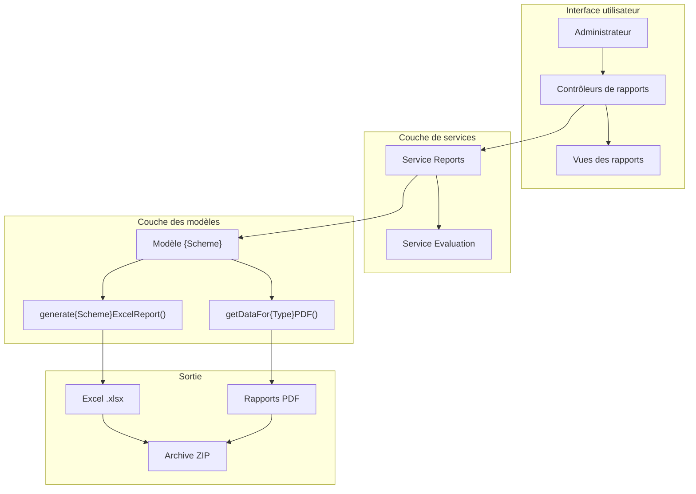
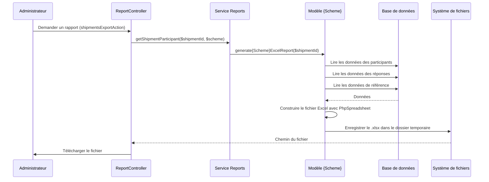

# Guide de l'architecture des programmes

Ce document explique l'organisation des programmes de tests (DTS, VL, EID, TB, Recency, COVID-19, DBS, Tests personnalisés) dans le projet ePT. Utilisez-le comme référence pour maintenir les programmes existants ou en ajouter de nouveaux.

---

## Table des matières {#table-of-contents}

1. [Vue d'ensemble](#overview)
2. [Structure des répertoires](#directory-structure)
3. [Composants d'un programme](#scheme-components)
4. [Flux de données](#data-flow)
5. [Tables de la base de données](#database-tables)
6. [Ajouter un nouveau programme](#adding-a-new-scheme)
7. [Détails propres à chaque programme](#scheme-specific-details)
8. [Configuration](#configuration)
9. [Cycle de vie d'une expédition](#shipment-lifecycle)
10. [Formule de notation](#scoring-formula)
11. [Génération des rapports et export Excel](#report-generation-excel-export)
12. [Documentation associée](#related-documentation)

---

## Vue d'ensemble {#overview}

Chaque programme d'ePT suit la même architecture MVC :



| Composant | Rôle | Emplacement |
|-----------|---------|----------|
| **Model** | Logique d'évaluation, notation, rapports | `application/models/{Scheme}.php` |
| **Controller** | Traitement des requêtes, saisie des réponses | `application/controllers/{Scheme}Controller.php` |
| **Views** | Formulaires de réponse des participants | `application/views/scripts/{scheme}/` |
| **DbTable** | Persistance en base de données | `application/models/DbTable/Response{Scheme}.php` |
| **Admin Partial** | Formulaires d'ajout et de modification des expéditions | `application/modules/admin/views/scripts/shipment/partials/schemes/{scheme}.phtml` |

---

## Structure des répertoires {#directory-structure}

```
application/
├── models/
│   ├── Dts.php                    # DTS evaluation & reports
│   ├── Vl.php                     # VL evaluation & reports
│   ├── Tb.php                     # TB evaluation & reports
│   ├── Eid.php                    # EID evaluation & reports
│   ├── Recency.php                # Recency evaluation & reports
│   ├── Covid19.php                # COVID-19 evaluation & reports
│   ├── CustomTest.php             # Custom Tests evaluation
│   └── DbTable/
│       ├── ResponseDts.php        # response_result_dts table
│       ├── ResponseVl.php         # response_result_vl table
│       ├── ResponseTb.php         # response_result_tb table
│       ├── ResponseEid.php        # response_result_eid table
│       ├── ResponseRecency.php    # response_result_recency table
│       ├── ResponseCovid19.php    # response_result_covid19 table
│       ├── ResponseDbs.php        # response_result_dbs table
│       ├── ResponseGenericTest.php # response_result_generic_test table (Custom Tests)
│       ├── Shipments.php          # shipment table
│       └── ShipmentParticipantMap.php # shipment_participant_map table
│
├── controllers/
│   ├── DtsController.php          # DTS response entry
│   ├── VlController.php           # VL response entry
│   ├── TbController.php           # TB response entry
│   ├── EidController.php          # EID response entry
│   ├── RecencyController.php      # Recency response entry
│   ├── Covid19Controller.php      # COVID-19 response entry
│   ├── DbsController.php          # DBS response entry
│   └── CustomTestController.php   # Custom Tests response entry
│
├── views/scripts/
│   ├── dts/response.phtml         # DTS response form
│   ├── vl/response.phtml          # VL response form
│   ├── tb/response.phtml          # TB response form
│   ├── eid/response.phtml         # EID response form
│   ├── recency/response.phtml     # Recency response form
│   ├── covid19/response.phtml     # COVID-19 response form
│   ├── dbs/response.phtml         # DBS response form
│   └── custom-test/response.phtml # Custom Tests response form
│
├── services/
│   ├── Shipments.php              # updateDtsResults(), updateVlResults(), etc.
│   ├── Schemes.php                # getPossibleResults(), getSchemeControls(), etc.
│   ├── Evaluation.php             # Evaluation workflow management
│   └── Reports.php                # Report generation
│
└── modules/admin/views/scripts/shipment/
    ├── edit.phtml                 # Slim wrapper (includes partials)
    ├── get-sample-form.ajax.phtml # AJAX loader for ADD flow
    └── partials/
        ├── common/
        │   ├── form-header.phtml  # Shared header fields
        │   ├── form-footer.phtml  # Submit buttons
        │   └── form-scripts.phtml # Shared JavaScript
        └── schemes/
            ├── dts.phtml          # DTS shipment form
            ├── vl.phtml           # VL shipment form
            ├── tb.phtml           # TB shipment form
            ├── eid.phtml          # EID shipment form
            ├── recency.phtml      # Recency shipment form
            ├── covid19.phtml      # COVID-19 shipment form
            ├── dbs.phtml          # DBS shipment form
            └── generic.phtml      # Custom Tests shipment form
```

---

## Composants d'un programme {#scheme-components}

### 1. Modèle (`application/models/{Scheme}.php`) {#1-model-applicationmodelsschemephp}

Chaque modèle de programme contient la méthode `evaluate()`. Elle porte la logique d'évaluation principale :

```php
public function evaluate($shipmentResult, $shipmentId, $reEvaluate = false)
{
    // 1. Fetch reference results
    // 2. Compare participant responses vs reference
    // 3. Calculate scores (response + documentation)
    // 4. Determine pass/fail
    // 5. Update shipment_participant_map with results
    // 6. Return evaluation summary
}
```

**Méthodes principales des modèles :**

| Méthode | Rôle |
|--------|---------|
| `evaluate()` | Logique de notation principale |
| `generate{Scheme}ExcelReport()` | Génération du rapport Excel |
| `getDataForIndividualPDFBatch()` | Données des rapports PDF |
| `get{Scheme}Samples()` | Lecture des données des échantillons |

**Taille des modèles (indicateur de complexité) :**
- Dts.php : 173K (le plus complexe, plusieurs algorithmes)
- Tb.php : 142K (moléculaire et microscopie)
- Vl.php : 140K (calculs de Z-score)
- CustomTest.php : 81K
- Covid19.php : 75K
- Recency.php : 62K
- Eid.php : 25K (le plus simple)

### 2. Contrôleur (`application/controllers/{Scheme}Controller.php`) {#2-controller-applicationcontrollersschemecontrollerphp}

Le contrôleur traite la saisie des réponses par les participants :

```php
public function responseAction()
{
    if ($this->getRequest()->isPost()) {
        // Save results via service layer
        $this->shipmentService->update{Scheme}Results($data);
        // Redirect appropriately
    } else {
        // Load form data
        $this->view->samples = $this->schemeService->get{Scheme}Samples();
        $this->view->possibleResults = $this->schemeService->getPossibleResults();
        // Render response.phtml
    }
}
```

**Actions courantes des contrôleurs :**
- `responseAction()` : saisie principale de la réponse (GET : affiche le formulaire, POST : enregistre)
- `downloadAction()` : télécharge les données de référence ou les rapports
- `deleteAction()` : supprime la réponse (le cas échéant)

### 3. Vue de réponse (`application/views/scripts/{scheme}/response.phtml`) {#3-response-view-applicationviewsscriptsschemeresponsephtml}

Formulaire destiné aux participants pour saisir les résultats des tests. Éléments courants :

- Informations sur le laboratoire et le participant
- Dates de réception et de test
- Choix de la technique ou du kit
- Tableau des résultats (colonnes propres au programme)
- Section de contrôle qualité (conditionnelle)
- Validation par le superviseur
- Envoi de fichiers (certains programmes)
- Saisie manuelle forcée (administrateur uniquement)

### 4. DbTable (`application/models/DbTable/Response{Scheme}.php`) {#4-dbtable-applicationmodelsdbtableresponseschemephp}

Couche de persistance en base de données :

```php
class Application_Model_DbTable_ResponseDts extends Zend_Db_Table_Abstract
{
    protected $_name = 'response_result_dts';
    protected $_primary = array('shipment_map_id', 'sample_id');

    public function updateResults($params)
    {
        // Insert or update response records
    }

    public function updateResultsByAPI($params, $dm)
    {
        // API-based result submission
    }
}
```

### 5. Partial d'administration (`partials/schemes/{scheme}.phtml`) {#5-admin-partial-partialsschemesschemephtml}

Formulaire unifié d'ajout et de modification des expéditions. Il fonctionne pour les deux flux :

```php
<?php
// Mode detection
$isEditMode = isset($this->shipmentData) && !empty($this->shipmentData);

// Normalize data
$samples = $isEditMode
    ? $this->shipmentData['reference']
    : $this->schemeControls;

$possibleResults = $isEditMode
    ? $this->shipmentData['possibleResults']
    : $this->schemePossibleResults;
?>
<!-- Form HTML works for both ADD and EDIT -->
```

---

## Flux de données {#data-flow}

### Flux de réponse du participant {#participant-response-flow}



### Flux d'évaluation {#evaluation-flow}



### Flux de création d'une expédition (administrateur) {#shipment-creation-flow-admin}



---

## Tables de la base de données {#database-tables}

### Tables principales {#core-tables}

| Table | Rôle |
|-------|---------|
| `shipment` | Métadonnées, état et configuration de l'expédition |
| `shipment_participant_map` | Relie les expéditions aux participants et stocke les scores |
| `scheme_list` | Définitions et configuration des programmes |

### Tables propres à chaque programme {#per-scheme-tables}

| Programme | Table des réponses | Table de référence |
|--------|---------------|-----------------|
| DTS | `response_result_dts` | `reference_result_dts` |
| VL | `response_result_vl` | `reference_result_vl` |
| TB | `response_result_tb` | `reference_result_tb` |
| EID | `response_result_eid` | `reference_result_eid` |
| Recency | `response_result_recency` | `reference_result_recency` |
| COVID-19 | `response_result_covid19` | `reference_result_covid19` |
| DBS | `response_result_dbs` | `reference_result_dbs` |
| Tests personnalisés | `response_result_generic_test` | `reference_result_generic_test` |

### Relations entre les tables {#table-relationships}



---

## Ajouter un nouveau programme {#adding-a-new-scheme}

### Étape 1 : créer le modèle {#step-1-create-model}

Créez `application/models/NewScheme.php` :

```php
class Application_Model_NewScheme
{
    public function evaluate($shipmentResult, $shipmentId, $reEvaluate = false)
    {
        // Implement evaluation logic
    }

    public function generateNewSchemeExcelReport($shipmentId)
    {
        // Implement report generation
    }
}
```

### Étape 2 : créer la DbTable {#step-2-create-dbtable}

Créez `application/models/DbTable/ResponseNewScheme.php` :

```php
class Application_Model_DbTable_ResponseNewScheme extends Zend_Db_Table_Abstract
{
    protected $_name = 'response_result_newscheme';
    protected $_primary = array('shipment_map_id', 'sample_id');

    public function updateResults($params) { /* ... */ }
}
```

### Étape 3 : créer le contrôleur {#step-3-create-controller}

Créez `application/controllers/NewschemeController.php` :

```php
class NewschemeController extends Zend_Controller_Action
{
    public function responseAction()
    {
        // Handle GET and POST
    }
}
```

### Étape 4 : créer la vue de réponse {#step-4-create-response-view}

Créez `application/views/scripts/newscheme/response.phtml`

### Étape 5 : créer le partial d'administration {#step-5-create-admin-partial}

Créez `application/modules/admin/views/scripts/shipment/partials/schemes/newscheme.phtml`

### Étape 6 : mettre à jour les routeurs {#step-6-update-routers}

Ajoutez dans `get-sample-form.ajax.phtml` :
```php
} elseif ($this->scheme == 'newscheme') {
    include('partials/schemes/newscheme.phtml');
}
```

Ajoutez dans `edit.phtml` :
```php
} elseif ($shipmentData['shipment']['scheme_type'] == 'newscheme') {
    include dirname(__FILE__) . '/partials/schemes/newscheme.phtml';
}
```

### Étape 7 : mettre à jour la couche de services {#step-7-update-service-layer}

Ajoutez dans `Shipments.php` :
```php
public function updateNewSchemeResults($data)
{
    // Implement result saving logic
}
```

### Étape 8 : créer les tables de la base de données {#step-8-create-database-tables}

```sql
CREATE TABLE reference_result_newscheme (
    shipment_id INT,
    sample_id VARCHAR(255),
    -- scheme-specific fields
    PRIMARY KEY (shipment_id, sample_id)
);

CREATE TABLE response_result_newscheme (
    shipment_map_id INT,
    sample_id VARCHAR(255),
    -- scheme-specific fields
    PRIMARY KEY (shipment_map_id, sample_id)
);
```

---

## Détails propres à chaque programme {#scheme-specific-details}

### DTS (échantillon sur tube séché) {#dts-dried-tube-specimen}

- **Complexité** : élevée (plusieurs algorithmes, prise en charge du RTRI, test de la syphilis)
- **Fonctionnalités principales** :
  - Configuration du panel à 2 ou 3 tests
  - Plusieurs algorithmes de test (série, parallèle, etc.)
  - Fenêtres modales EIA/WB/Geenius pour les résultats détaillés
  - Tests de la syphilis et RTRI facultatifs
  - Notation selon l'algorithme

### VL (charge virale) {#vl-viral-load}

- **Complexité** : élevée (analyse quantitative)
- **Fonctionnalités principales** :
  - Évaluation fondée sur le Z-score
  - Calcul des plages par technique
  - Traitement des résultats TND (Target Not Detected, cible non détectée)
  - Prise en charge de la conversion en log10
  - Envoi de fichiers de données brutes

### TB (tuberculose) {#tb-tuberculosis}

- **Complexité** : élevée (plusieurs types de techniques)
- **Fonctionnalités principales** :
  - Types de tests moléculaire ou microscopie
  - Prise en charge de GeneXpert MTB/RIF et Ultra
  - Détection de la résistance à la rifampicine
  - Valeurs des sondes (A, B, C, D, E)
  - Suivi des instruments
  - Enregistrement en brouillon

### EID (diagnostic précoce du nourrisson) {#eid-early-infant-diagnosis}

- **Complexité** : faible (le programme le plus simple)
- **Fonctionnalités principales** :
  - Correspondance de résultats binaires
  - Saisie des valeurs CT/OD
  - Choix de la technique d'extraction

### Recency {#recency}

- **Complexité** : moyenne
- **Fonctionnalités principales** :
  - Prise en charge de l'algorithme RTRI
  - Interprétation des lignes de contrôle, de vérification et long terme
  - Classification de récence (négatif, récent, long terme)

### COVID-19 {#covid-19}

- **Complexité** : moyenne
- **Fonctionnalités principales** :
  - Prise en charge de 1 à 3 plateformes de test
  - Suivi des réactifs PCR
  - Identification des types de gènes
  - Validation des plateformes

### DBS (goutte de sang séché) {#dbs-dried-blood-spot}

- **Complexité** : moyenne à élevée
- **Fonctionnalités principales** :
  - Plusieurs tests EIA (jusqu'à 3)
  - Western Blot avec 9 bandes protéiques
  - Valeurs OD et seuils

### Tests personnalisés {#custom-tests}

- **Complexité** : configurable
- **Fonctionnalités principales** :
  - Prise en charge des tests qualitatifs et quantitatifs
  - Seuils de réussite et d'échec configurables
  - Configuration dynamique des champs
  - Gestion de kits de test personnalisés

---

## Configuration {#configuration}

La configuration des programmes passe par `Pt_Commons_SchemeConfig::get('{scheme}')` :

```php
$config = Pt_Commons_SchemeConfig::get('dts');
// Returns: allowedAlgorithms, dtsSchemeType, rtriEnabled, etc.
```

La table `scheme_config` est la seule source. `sql/init.sql` crée une ligne pour chaque programme intégré. Les administrateurs modifient les valeurs dans **Configurer → Configuration des programmes**.

`config.ini` n'est plus utilisé. Sur les installations plus anciennes, `run-once/config-migration.php` a transféré ses valeurs dans `scheme_config`.

Les tests personnalisés fonctionnent autrement. Leurs définitions de champs sont stockées en JSON dans `scheme_list.user_test_config`.

---

## Cycle de vie d'une expédition {#shipment-lifecycle}



Le cycle de vie ci-dessus décrit des étapes du processus. Il ne reprend pas littéralement chaque état stocké en base de données.
Le traitement de la date limite peut aussi mettre l'évaluation en file. La génération et la finalisation sont des actions distinctes.

## Formule de notation {#scoring-formula}

La plupart des programmes suivent ce modèle :



**Formule :**

```text
Response Score = (Correct Responses / Max Possible) × (100 - Documentation%)
Documentation Score = Sum of documentation item scores
Final Score = Response Score + Documentation Score
Pass = Final Score >= Passing Percentage (configurable per scheme)
```

---

## Génération des rapports et export Excel {#report-generation-excel-export}

### Architecture des rapports {#report-architecture}



### Méthodes de rapport Excel par programme {#excel-report-methods-by-scheme}

Chaque modèle de programme possède une méthode dédiée à la génération du rapport Excel :

| Programme | Méthode du modèle | Sortie |
|--------|-------------|--------|
| DTS | `generateDtsRapidHivExcelReport($shipmentId)` | XLSX à plusieurs feuilles avec résultats des tests et scores |
| VL | `generateDtsViralLoadExcelReport($shipmentId)` | Détails des participants, résultats par technique, Z-scores |
| TB | `generateTbExcelReport($shipmentId)` | Liste des participants, résultats MTB/RIF |
| EID | `generateDbsEidExcelReport($shipmentId)` | Résultats PT EID, informations sur la technique |
| Recency | `generateRecencyExcelReport($shipmentId)` | Informations sur le laboratoire, résultats PT Recency |
| COVID-19 | `generateCovid19ExcelReport($shipmentId)` | Instructions, types de tests, réponses |
| Tests personnalisés | `generateGenericTestExcelReport($shipmentId, $schemeType)` | Liste des participants, réponses aux tests |

### Méthodes de génération des PDF {#pdf-generation-methods}

Certains programmes prennent en charge des rapports PDF individuels et récapitulatifs :

| Programme | PDF individuel | PDF récapitulatif |
|--------|---------------|-------------|
| TB | `getDataForIndividualPDFBatch($mapIds)` | `getDataForSummaryPDF($shipmentId)` |
| VL | `getDataForIndividualPDFBatch($shipmentId, $mapIds, $attributes)` | - |
| Tests personnalisés | - | `getDataForSummaryPDF($shipmentId)` |

### Contrôleurs de rapports {#report-controllers}

Situés dans `application/modules/reports/controllers/` :

| Contrôleur | Actions principales | Rôle |
|------------|-------------|---------|
| `ShipmentsController` | `indexAction`, `shipmentsExportAction` | Rapports de synthèse des expéditions |
| `ShipmentResponseController` | `indexAction`, `shipmentsExportPdfAction` | Rapports sur les réponses |
| `FinalizeController` | `shipmentsAction`, `sendReportMailAction` | Rapports finalisés |
| `ParticipantPerformanceController` | `indexAction`, `exportAction` | Analyse des performances |
| `ParticipantTrendsController` | `indexAction` | Analyse des tendances |
| `CorrectiveActionsController` | `indexAction` | Rapports sur les actions correctives |
| `TbResultsController` | `indexAction` | Résultats propres à la TB |
| `TbAllSitesResultsController` | `indexAction` | Rapports TB multisites |

### Service Reports (`application/services/Reports.php`) {#report-service-applicationservicesreportsphp}

Point central d'orchestration de la génération des rapports :

```php
// Route to scheme-specific Excel generation
public function getShipmentParticipant($shipmentId, $schemeType = null)
{
    switch ($schemeType) {
        case 'dts': return $this->dtsModel->generateDtsRapidHivExcelReport($shipmentId);
        case 'vl': return $this->vlModel->generateDtsViralLoadExcelReport($shipmentId);
        case 'tb': return $this->tbModel->generateTbExcelReport($shipmentId);
        // ... etc
    }
}

// Generate overview report
public function exportShipmentsReport($params)
{
    // Creates "Shipment Response Overview" Excel
    // Columns: scheme, shipment code, sample label, responses, pass rates
}
```

### Flux de génération d'un rapport {#report-flow}



### Emplacements des fichiers produits {#file-output-locations}

| Type | Chemin | Exemple |
|------|------|---------|
| Exports temporaires | `TEMP_UPLOAD_PATH/` | `shipment-response-1706284800.xlsx` |
| PDF récapitulatifs | `/downloads/reports/{code}/` | `DTS-2024-01-summary.pdf` |
| PDF individuels | `/downloads/reports/{code}/` | `DTS-2024-01-{participant}.pdf` |
| Archives ZIP | `/downloads/reports/` | `DTS-2024-01.zip` |
| Formulaires TB | `TEMP_UPLOAD_PATH/` | `DTS-2024-01-TB-FORMS.zip` |

### Structure d'un rapport Excel (exemple : DTS) {#excel-report-structure-example-dts}

```
DTS-Shipment-Report.xlsx
├── Sheet 1: Instructions
│   └── Tab descriptions, color coding legend
├── Sheet 2: Participant List
│   └── Lab ID, Name, Country, Region, Site Type
├── Sheet 3: PT Results
│   └── Sample, Test 1/2/3 Results, Final Result, Score
├── Sheet 4: Panel Score
│   └── Per-sample scoring breakdown
├── Sheet 5: Documentation Score
│   └── Receipt date, rehydration, testing date scores
└── Sheet 6: Total Score
    └── Response + Documentation = Final Score, Pass/Fail
```

### Formats d'export pris en charge {#supported-export-formats}

| Format | Bibliothèque | Usage |
|--------|---------|----------|
| Excel (.xlsx) | PhpOffice\PhpSpreadsheet | Export détaillé des données, analyse |
| PDF | TCPDF/Custom | Certificats individuels, récapitulatifs |
| ZIP | ZipArchive | Téléchargements groupés, tous les rapports réunis |

### Ajouter des rapports pour un nouveau programme {#adding-reports-for-new-scheme}

1. **Ajoutez la méthode Excel au modèle** :
```php
public function generateNewSchemeExcelReport($shipmentId)
{
    $excel = new Spreadsheet();
    // Build sheets...
    $writer = IOFactory::createWriter($excel, 'Xlsx');
    $filename = 'newscheme-' . $shipmentId . '.xlsx';
    $writer->save(TEMP_UPLOAD_PATH . '/' . $filename);
    return $filename;
}
```

2. **Ajoutez le cas au service Reports** :
```php
case 'newscheme':
    return $this->newSchemeModel->generateNewSchemeExcelReport($shipmentId);
```

3. **Ajoutez la prise en charge des PDF (facultatif)** :
```php
public function getDataForIndividualPDFBatch($mapIds)
{
    // Fetch data for PDF generation
}
```

---

## Documentation associée {#related-documentation}

- [Formulaires d'expédition de l'administration](https://github.com/deforay/ept/blob/master/application/modules/admin/views/scripts/shipment/partials/README.md) (en anglais)
- Migrations de la base de données dans `/database/migrations/`
- Documentation de l'API pour les intégrations externes
