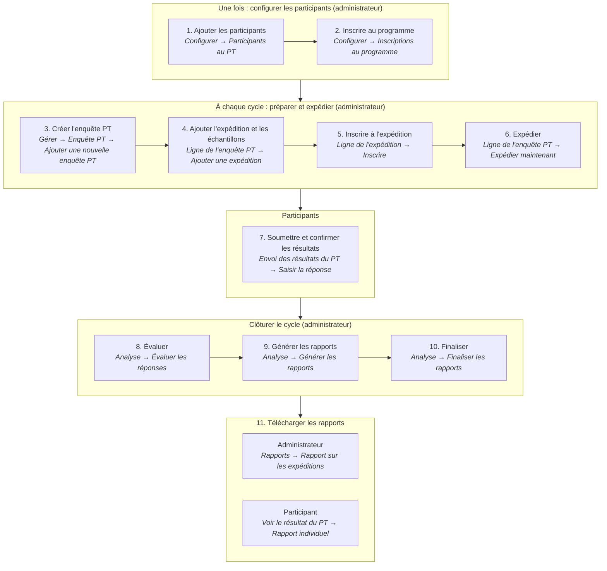

# Parcours de formation ePT

## À propos de cette formation {#about-this-training}

**Qu'est-ce qu'ePT ?** Une application web utilisée par les fournisseurs PT pour gérer le cycle de vie des essais d'aptitude (PT). Elle couvre la création des enquêtes, l'inscription des participants, l'évaluation des résultats et la génération des rapports.

**À qui s'adresse-t-elle ?** Aux formateurs et aux responsables PT qui gèrent le programme PT ou animent des formations en cascade. La partie Participant (partie 3) peut être dispensée seule, comme module autonome, pour une formation en cascade réservée aux participants.

**Durée :** 30 à 45 minutes au total

---

## Parcours {#curriculum}

| Partie | Thème | Public | Durée |
|------|-------|----------|----------|
| [Partie 1](part1-setup-and-participants.md) | Configuration du système et gestion des participants | Administrateur | ~10 min |
| [Partie 2](part2-surveys-and-shipments.md) | Gestion des enquêtes PT et des expéditions | Administrateur | ~10 min |
| [Partie 3](part3-participant.md) | Participant : soumission des résultats et rapports | Participant | ~5 à 10 min |
| [Partie 4](part4-evaluation-and-reports.md) | Évaluation, rapports et finalisation | Administrateur | ~10 min |

> **Pour une formation en cascade des participants :** dispensez uniquement la [partie 3](part3-participant.md). Elle est autonome et couvre tout ce qu'un participant doit savoir.

---

## Exercices {#exercises}

Exercices pratiques à suivre pendant ou après la formation :

- [Sérologie du VIH sur DTS](exercises/dts-hiv-serology.md)

---

## Aide-mémoire : le cycle de vie PT complet {#quick-reference-the-full-pt-lifecycle}

Configurez les participants une seule fois. Répétez le reste à chaque cycle PT.

L'inscription au programme détermine qui est sélectionné par défaut à l'étape 5. Vous pouvez ajouter ou retirer des participants pour chaque expédition.

---

## Dispenser cette formation {#delivering-this-training}

| Situation | Contenu à couvrir | Durée |
|----------|---------------|----------|
| Formation complète des responsables PT et des formateurs | Parties 1 à 4 | 30 à 45 min |
| Formation en cascade réservée aux participants | Partie 3 uniquement | 5 à 10 min |
| Remise à niveau des administrateurs existants | Parties 2 et 4 (gestion des enquêtes et évaluation) | 15 à 20 min |

**Approche recommandée :**

- Utilisez une installation ePT de test ou de formation
- Suivez l'[exercice de sérologie du VIH sur DTS](exercises/dts-hiv-serology.md) pour la pratique
- Faites réaliser l'exercice aux participants pendant la formation ou juste après
