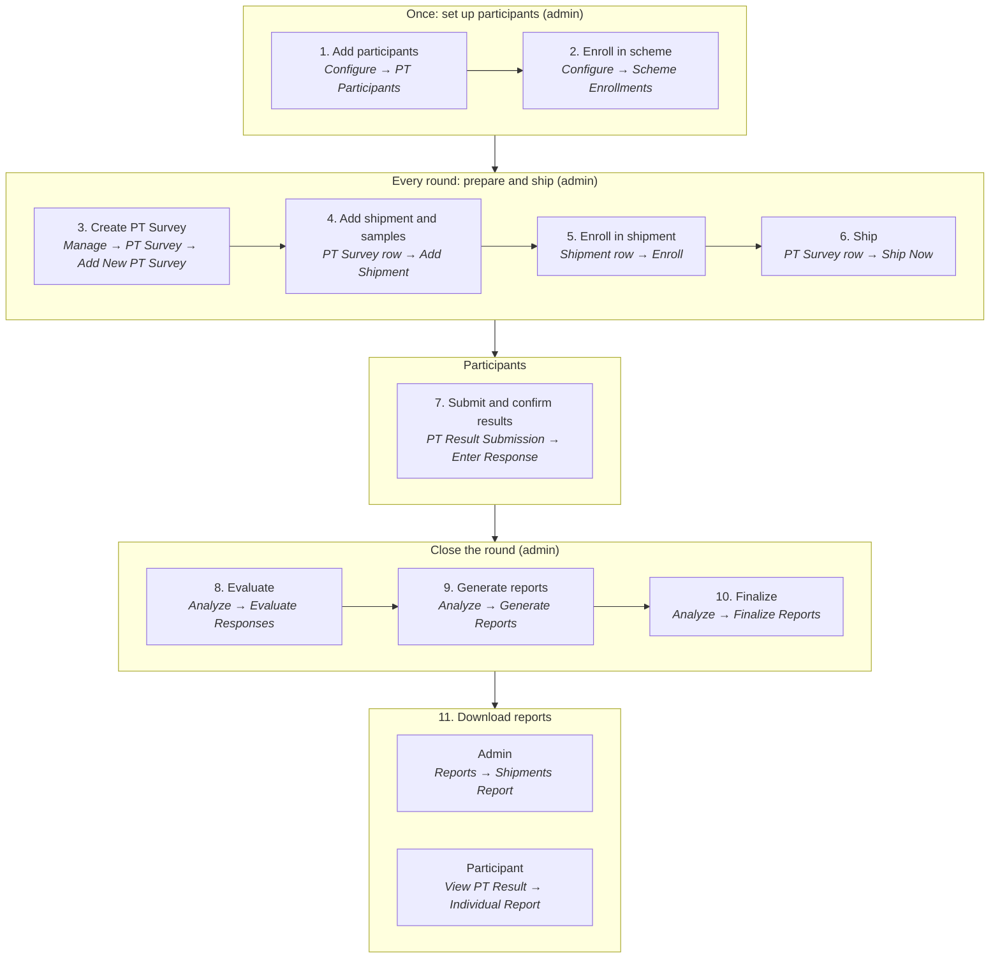

# ePT Training Curriculum

## About this training

**What is ePT?** A web-based application used by PT Providers to manage the Proficiency Testing lifecycle — from creating surveys and enrolling participants, to evaluating results and generating reports.

**Who is this for?** Trainers and PT Managers who will manage the PT program or conduct step-down trainings. The Participant section (Part 3) can be delivered as a standalone module for participant-only step-down training.

**Duration:** 30–45 minutes total

---

## Curriculum

| Part | Topic | Audience | Duration |
|------|-------|----------|----------|
| [Part 1](part1-setup-and-participants.md) | System Setup & Participant Management | Admin | ~10 min |
| [Part 2](part2-surveys-and-shipments.md) | PT Survey & Shipment Management | Admin | ~10 min |
| [Part 3](part3-participant.md) | Participant — Result Submission & Reports | Participant | ~5–10 min |
| [Part 4](part4-evaluation-and-reports.md) | Evaluation, Reports & Finalization | Admin | ~10 min |

> **For step-down participant training:** Deliver only [Part 3](part3-participant.md). It is self-contained and covers everything a participant needs to know.

---

## Exercises

Hands-on exercises to follow along during or after the training:

- [DTS HIV Serology](exercises/dts-hiv-serology.md)

---

## Quick reference: the full PT lifecycle

Set up participants once. Repeat the rest for every PT round.

Scheme enrollment sets who is selected by default in step 5. You can add or remove participants for each shipment.

---

## Delivering this training

| Scenario | What to cover | Duration |
|----------|---------------|----------|
| Full training for PT Managers / Trainers | Parts 1–4 | 30–45 min |
| Step-down training for participants only | Part 3 only | 5–10 min |
| Refresher for existing admins | Parts 2 + 4 (survey management + evaluation) | 15–20 min |

**Recommended approach:**

- Use a test/training instance of ePT
- Follow along with the [DTS HIV Serology exercise](exercises/dts-hiv-serology.md) for hands-on practice
- Have participants complete the exercise during or immediately after the training
